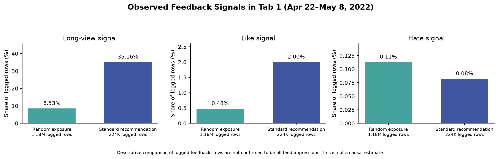
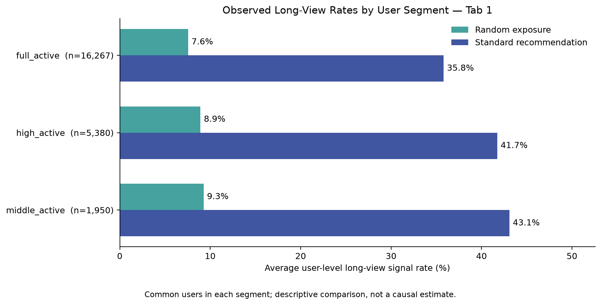
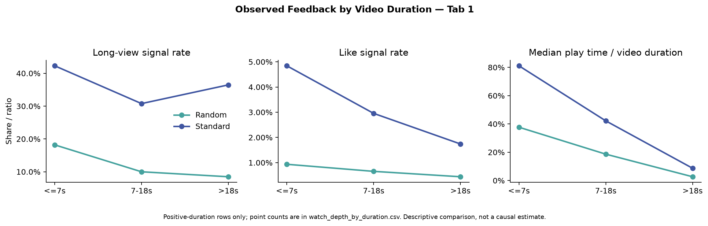
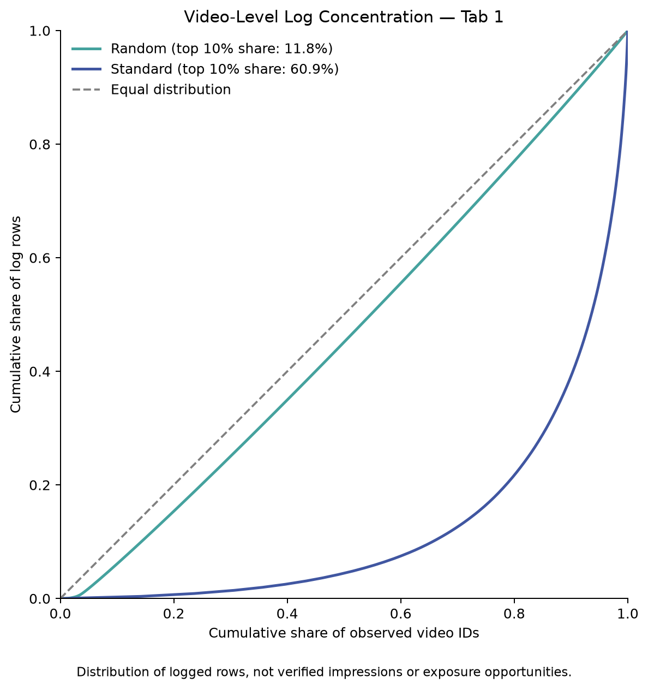

## Key findings

- Among users present in both logs on Tab 1, the average user-level long-view signal rate was 8.1% in the random-exposure log and 37.9% in the standard-recommendation log. The paired user bootstrap difference was -29.79 percentage points (95% interval: -30.15 to -29.45).
- The observed difference remained across video-duration groups. In the log-row distribution, the most-recorded 10% of video IDs accounted for 11.8% of random-exposure rows and 60.9% of standard-recommendation rows.

## Limitations

- The dataset contains Kuaishou logs collected in 2022; results should not be generalized to TikTok or current user behavior.
- The released logs have not been verified as complete impression opportunities. Rates are based on logged rows, not confirmed CTR denominators.
- Random-exposure and standard-recommendation logs differ in their logged items and event volume. These comparisons are descriptive and do not establish causal policy impact.
- Video durations at or below zero were excluded from duration-ratio analysis. The supplied `long_view` field was retained despite a small discrepancy with a literal reconstruction of the documented threshold.

# Short-Video Recommendation: Engagement and Log Concentration

## Project question

How do logged feedback signals differ between random-intervention and standard-recommendation records, and how concentrated are logged interactions across videos?

## Dataset and scope

This project uses KuaiRand-Pure, a short-video recommendation dataset collected from Kuaishou. The primary comparison covers Tab 1 logs from April 22 to May 8, 2022. A log row is analyzed as a logged record; it is not assumed to represent a complete set of eligible impressions.

Dataset source: [KuaiRand official repository](https://github.com/chongminggao/KuaiRand). Please follow the dataset license and attribution terms.

## Methods

- Used DuckDB SQL to inspect schemas, validate keys, and aggregate feedback by tab, video duration, video type, and user segment.
- Compared user-level long-view rates among 24,513 users present in both Tab 1 logs; calculated a paired user bootstrap interval using 2,000 resamples.
- Used a Lorenz curve and top-item shares to describe how log rows are distributed across the observed video IDs.
- Used Python and Matplotlib to create the charts.

## Visualizations

### Feedback signals by log type

### User-level long-view rates by documented user segment

### Feedback by video duration

### Video-level log concentration

